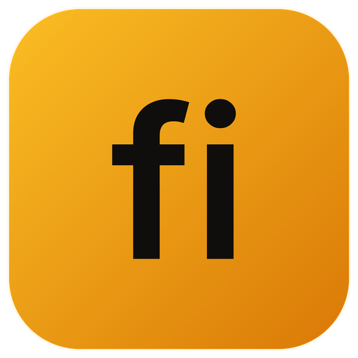
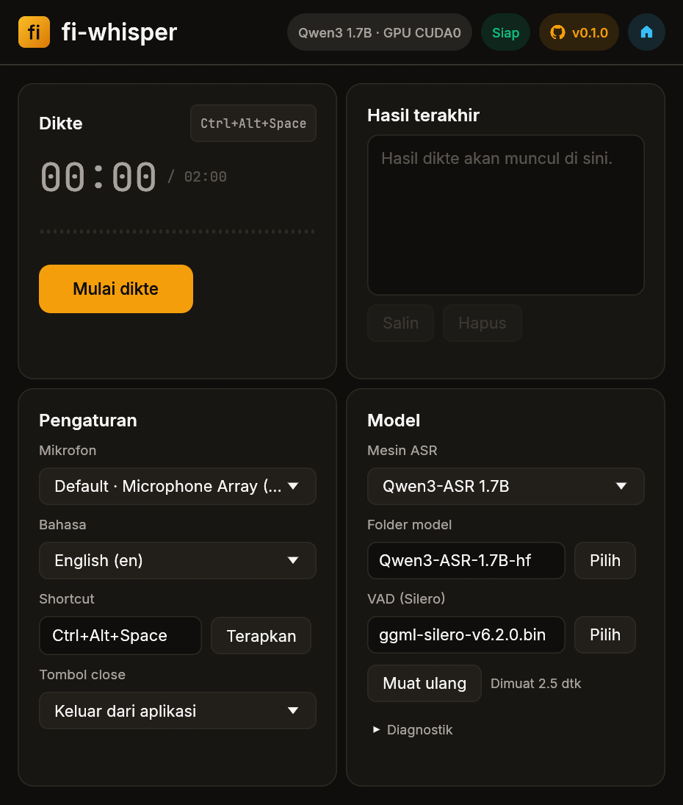
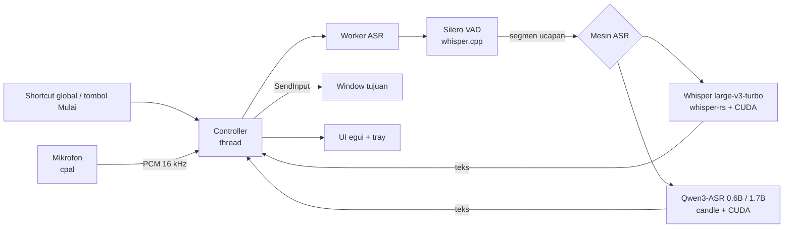

<p align="center"></p>

<h1 align="center">fi-whisper</h1>

<p align="center">
  
  
  
  
</p>

Aplikasi Automatic Speech Recognition (ASR) atau dikte, berjalan secara lokal tanpa internet untuk Windows, dibuat dengan Rust dan egui. Tanpa koneksi jaringan dan telemetri apapun.

<p align="center"></p>

## Model

| Nama Model | Lokasi | Sumber | Kebutuhan Sumber Daya |
| --- | --- | --- | --- |
| Whisper large-v3-turbo | `whisper-large-v3-turbo\ggml-large-v3-turbo.bin` | [whisper.cpp](https://huggingface.co/ggerganov/whisper.cpp/resolve/5359861c739e955e79d9a303bcbc70fb988958b1/ggml-large-v3-turbo.bin?download=true) | ~1,6 GB |
| Qwen3-ASR 0.6B | `Qwen3-ASR-0.6B-hf\` (`config.json`, `model.safetensors`, `tokenizer.json`) | [Qwen3-ASR-0.6B-hf @ 7f1569a](https://huggingface.co/Qwen/Qwen3-ASR-0.6B-hf/tree/7f1569a48a89f3e3f4dc3a5c9d28bddd903bc76c) | ~1,6 GB VRAM / ~3 GB RAM |
| Qwen3-ASR 1.7B | `Qwen3-ASR-1.7B-hf\` (tiga file yang sama) | [Qwen3-ASR-1.7B-hf @ bcd2b5b](https://huggingface.co/Qwen/Qwen3-ASR-1.7B-hf/tree/bcd2b5b7f32b480ab5790554cfa8347f246a14f3) | ~4 GB VRAM / ~8 GB RAM |
| Silero VAD (wajib) | `silero-vad-v6.2.0\ggml-silero-v6.2.0.bin` | [whisper-vad](https://huggingface.co/ggml-org/whisper-vad/resolve/9ffd54a1e1ee413ddf265af9913beaf518d1639b/ggml-silero-v6.2.0.bin?download=true) | <1 MB |

Pada GPU RTX 5060 Laptop dengan CUDA, ketiga model memproses audio selama 8-9 detik dalam 0,3-0,6 detik. Qwen3-ASR 1.7B memberi tanda baca dan kapitalisasi paling rapi untuk bahasa Indonesia. Rincian tes ada di [uji model](docs/MODEL-TEST.md).

## Arsitektur


## Pemakaian

Tekan shortcut untuk menjalankan deteksi ucapan, ngomong, terus tekan shortcut lagi untuk berhenti deteksi. Teks akan dimasukkan otomatis ke program yang dituju. File settings (mesin, model, mikrofon, bahasa, shortcut) tersimpan di `%LOCALAPPDATA%\fi-whisper\config.json`, dan file tidak ditimpa sampai memilih opsi Reset. Rekaman berhenti otomatis setelah 2 menit, dan hasil hanya tersimpan di RAM. Tombol close bisa menyembunyikan ke tray atau keluar dari aplikasi, ada pengaturannya.

Teks tidak dimasukkan bila jendela tujuan berubah, tertutup, atau modifier masih ditekan, dan hasilnya tetap bisa disalin. Aplikasi yang berjalan sebagai administrator tidak menerima input, dan tidak ada deteksi field password. Lihat juga [validasi](docs/VALIDATION.md) dan [atribusi](docs/CREDITS.md). Kode berlisensi [MIT](LICENSE); font, ikon, dan model mengikuti lisensinya masing-masing.

## Build

Mau build manual? kamu butuh Rust MSVC 1.95+, Visual Studio Build Tools (C++), CMake, dan LLVM untuk bindgen. `.cargo/config.toml` memaksa `/O2` untuk whisper.cpp, karena tanpa flag itu inferensi sekitar 10x lebih lambat. Build CUDA menargetkan `sm_120` (RTX 50xx) dan butuh driver yang melaporkan CUDA 13.2+ untuk Qwen. Kalau drivermu lawas atau GPU-mu kentang, modal otomatis jalan di CPU dan aplikasi akan menampilkan keterangan.

```powershell
cargo build --locked --release                         # CPU
./scripts/setup-cuda.ps1                               # sekali: ~460 MB komponen CUDA 13.2.2 ke .local/
./scripts/build-cuda.ps1 build --locked --release      # Whisper + Qwen di GPU
./scripts/build-cuda.ps1 test --release '--' --ignored fixture --nocapture
./scripts/package.ps1                                  # dist/fi-whisper: exe, DLL CUDA, logo, lisensi
```


