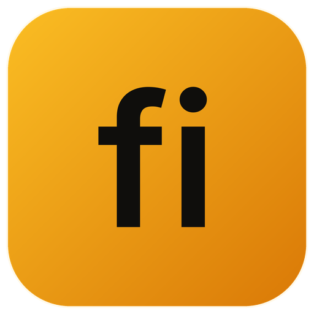
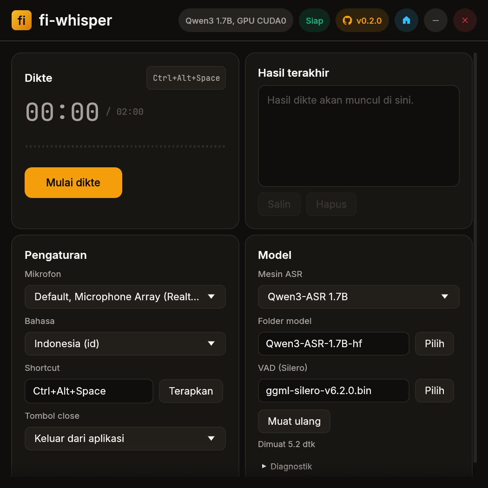
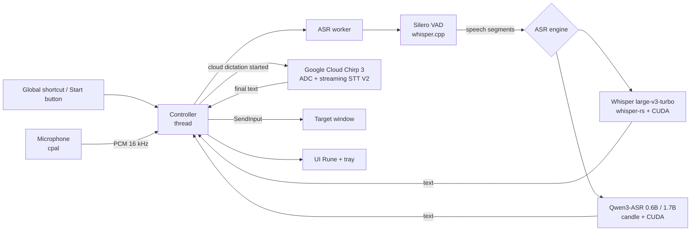

<p align="center"></p>

<h1 align="center">fi-whisper</h1>

<p align="center">
  
  
  
  
</p>

<p align="center">Automatic Speech Recognition (ASR) software for Windows. Run locally without internet, or use Google Chirp. Built with Rust. Because your rambling is your business, i give you zero telemetry.</p>

<p align="center"></p>

## License

MIT. Fork, copy-paste, rebrand, slap a shiny landing page on it, call it your own invention (like how [Raymond Chin](https://github.com/raymondchins/Bridgeplay/issues/79) does), i don't care. Nobody will open an issue titled "This should not exist", and your reply can be written by whatever AI you like, I won't check. The only ask: keep the MIT license text with the code. That's it.

Third-party licenses (Whisper, Qwen3-ASR, Silero VAD, CUDA components) belong to their own authors, so don't blame me, see `docs/CREDITS.md`.

## Local models

| Model | Location | Source | Resources |
| --- | --- | --- | --- |
| Whisper large-v3-turbo | `whisper-large-v3-turbo\ggml-large-v3-turbo.bin` | [whisper.cpp](https://huggingface.co/ggerganov/whisper.cpp/resolve/5359861c739e955e79d9a303bcbc70fb988958b1/ggml-large-v3-turbo.bin?download=true) | ~1.6 GB |
| Qwen3-ASR 0.6B | `Qwen3-ASR-0.6B-hf\` (`config.json`, `model.safetensors`, `tokenizer.json`) | [Qwen3-ASR-0.6B-hf @ 7f1569a](https://huggingface.co/Qwen/Qwen3-ASR-0.6B-hf/tree/7f1569a48a89f3e3f4dc3a5c9d28bddd903bc76c) | ~1.6 GB VRAM / ~3 GB RAM |
| Qwen3-ASR 1.7B | `Qwen3-ASR-1.7B-hf\` (same three files) | [Qwen3-ASR-1.7B-hf @ bcd2b5b](https://huggingface.co/Qwen/Qwen3-ASR-1.7B-hf/tree/bcd2b5b7f32b480ab5790554cfa8347f246a14f3) | ~4 GB VRAM / ~8 GB RAM |
| Silero VAD (required for local engines) | `silero-vad-v6.2.0\ggml-silero-v6.2.0.bin` | [whisper-vad](https://huggingface.co/ggml-org/whisper-vad/resolve/9ffd54a1e1ee413ddf265af9913beaf518d1639b/ggml-silero-v6.2.0.bin?download=true) | <1 MB |

On an RTX 5060 Laptop GPU with CUDA, all three models processed 8-9 seconds of audio in 0.3-0.6 seconds in local tests. Qwen3-ASR 1.7B produced the cleanest Indonesian punctuation and capitalization. See the [model tests](docs/MODEL-TEST.md).

## Architecture


## Usage

Press the shortcut, talk, then press it again to stop. Your words land in the target app. Recording stops automatically after two minutes, audio and results stay in RAM. The GUI button keeps results inside fi-whisper for manual copying.

Settings (engine, models, microphone, language, shortcut) live in `%LOCALAPPDATA%\fi-whisper\config.json`. Choose whether closing the window hides it to the tray or quits. Select **English (US)** under Language to switch the interface to English and use English recognition.

## Build

Building it for yourself? Bring it on! You need Rust (MSVC 1.95+), Visual Studio Build Tools (C++), CMake, and LLVM for bindgen. CUDA builds target `sm_120` (RTX 50xx), and Qwen needs a driver reporting CUDA 13.2+. Old driver or potato device? No worries, model falls back to CPU and the app tells you.

```powershell
cargo build --locked --release                         # CPU
./scripts/setup-cuda.ps1                               # once: ~460 MB of CUDA 13.2.2 components in .local/
./scripts/build-cuda.ps1 build --locked --release      # Whisper + Qwen on GPU
./scripts/build-cuda.ps1 test --release '--' --ignored fixture --nocapture
./scripts/package.ps1                                  # dist/fi-whisper: exe, CUDA DLLs, logo, licenses
```

### Google Cloud Chirp 3

Select **Google Cloud - Chirp 3**, enter your Project ID and region (`us` or `eu`), then start dictation to send audio to Google. The project needs active billing. The ADC account needs Speech Client and permission to use the quota project.

Initial setup with the Google Cloud CLI:

```powershell
gcloud services enable speech.googleapis.com --project=PROJECT_ID
gcloud auth application-default login
gcloud auth application-default set-quota-project PROJECT_ID
```
